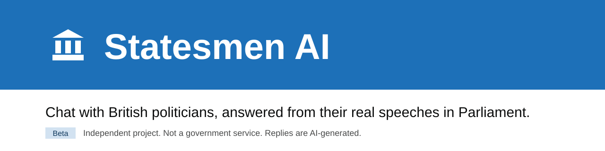

<div align="center">



**Chat with British politicians, answered from their real speeches in Parliament.**

[Live app](https://statesmen-ai.vercel.app) · [Design system](https://statesmen-ai.vercel.app/design)

[](https://nextjs.org/)
[](https://react.dev/)
[](https://www.typescriptlang.org/)
[](https://tailwindcss.com/)
[](https://neon.com)
[](https://modal.com)
[](https://groq.com)

</div>

> Statesmen AI is an independent project. It is not a government service and
> is not affiliated with UK Parliament. Replies are AI-generated and are not
> real statements by the people shown.

## What it does

Pick a Prime Minister, MP or Lord and ask them a question. The reply is
written in their voice and drawn from their real speeches in
[Hansard](https://hansard.parliament.uk), the official record of Parliament.

- **Prime Ministers on the home page**, and search for any current or former
  MP or Lord.
- **Answers grounded in real speeches.** Every question is matched to the
  person's five closest speeches by meaning, and the reply is written from
  those.
- **Sources under every reply.** A "Speeches used for this answer" section
  lists each speech with its debate, date, an excerpt and a link to Hansard.
- **Anyone can be added.** The first chat with someone new builds their
  persona in about 30 to 50 seconds, with live progress. After that it is
  instant for everyone.
- **Era-aware.** Each persona knows when their time in Parliament ended and
  declines questions about later events.

## How it works

```
Build (once per person)                   Chat (every message)
───────────────────────                   ────────────────────
Members API → career and PM dates         question
        │                                     │
Hansard API → ~500 speeches,                  ▼
  sampled across the whole career      embed the question (Modal)
        │                                     │
        ▼                                     ▼
embed each speech (Modal,              5 closest speeches (Neon pgvector)
  Qwen3-Embedding-0.6B)                       │
        │                                     ▼
        ▼                              system prompt: rules, era cutoff,
save person + speeches + vectors         the 5 speeches
  (Neon Postgres)                             │
                                              ▼
                                       stream the reply (Groq) + sources
```

### Building a persona

1. **Career dates.** The Members API gives each spell in Parliament and any
   time as Prime Minister.
2. **Speech sampling.** The career is split into 12 date windows, half of
   them covering time as Prime Minister, and one page of speeches is fetched
   per window in parallel. Very short procedural remarks are dropped. Full
   speech text is used, not Hansard's 255-character search preview.
3. **Embedding.** Each speech becomes a 1,024-number vector on a
   Modal-hosted Qwen3-Embedding-0.6B (Hugging Face Text Embeddings
   Inference, A10G GPU).
4. **Saving.** The person, their speeches and the vectors are written to Neon
   in one transaction.

### Chatting

1. The latest question (plus the previous one, so follow-ups keep their
   topic) is embedded.
2. Neon returns the person's five closest speeches.
3. Groq streams a reply from `qwen/qwen3.8-27b` (thinking turned off) with a
   short set of rules: stay in character, use only these speeches for facts,
   respect the era cutoff.
4. The five speeches travel with the reply as message metadata and appear as
   its sources.

### Performance

- Chat pages are statically generated (ISR) and served from Vercel's edge;
  the build route refreshes a page as soon as its person is built.
- Person lookups are cached for an hour and deduplicated per request.
- Single reads use Neon's HTTP driver; only the build's multi-step save uses
  a WebSocket transaction.

## Tech stack

| Layer | Choice |
|---|---|
| Framework | Next.js 16 (App Router), React 19, TypeScript |
| UI | Tailwind CSS 4, Base UI, GOV.UK Design System aesthetics |
| Chat model | Groq, `qwen/qwen3.8-27b`, via the Vercel AI SDK v6 |
| Embeddings | Qwen3-Embedding-0.6B on Modal (Text Embeddings Inference, A10G) |
| Database | Neon Postgres with pgvector |
| Data | UK Parliament Members API and Hansard API (no key needed) |
| Hosting | Vercel |

## Design

The interface follows the [GOV.UK Design System](https://design-system.service.gov.uk)
for colour, type, spacing, focus states and components, using values from
GOV.UK Frontend 6.6.0. It deliberately does **not** use GOV.UK branding: Arial
replaces the GDS Transport font, and there is no crown or GOV.UK logotype. A
Beta phase banner and the footer state that this is not a government service.

Every token and component is on the living style guide at
[`/design`](https://statesmen-ai.vercel.app/design).

## Getting started

You need Node.js 24 (the version Vercel runs), a [Neon](https://neon.com) database, a
[Modal](https://modal.com) account and a [Groq](https://console.groq.com/keys)
API key.

```bash
git clone https://github.com/pradhankukiran/statesmen-ai
cd statesmen-ai
npm install
cp .env.example .env.local        # fill in the values below
```

**1. Create the database tables**

```bash
psql "$DATABASE_URL_UNPOOLED" -f db/schema.sql
```

**2. Deploy the embedding service**

```bash
modal secret create statesmen-embed-key API_KEY=$(openssl rand -hex 32)
modal deploy infra/embed.py
```

Put the printed URL in `EMBED_URL` and the same key in `EMBED_API_KEY`.

**3. Build the featured Prime Ministers and run the app**

```bash
npm run script:speeches -- --featured
npm run dev                       # http://localhost:3000
```

### Environment variables

| Variable | Purpose |
|---|---|
| `GROQ_API_KEY` | Streams chat replies |
| `GROQ_CHAT_MODEL` | Optional. Chat model, default `qwen/qwen3.8-27b` |
| `EMBED_URL` | Modal embedding service URL |
| `EMBED_API_KEY` | Bearer key for the embedding service |
| `DATABASE_URL` | Neon pooled connection string (used by the app) |
| `DATABASE_URL_UNPOOLED` | Neon direct connection string (for `psql`) |

On Vercel, adding Neon from the Marketplace fills in the database variables.

### Scripts

| Command | What it does |
|---|---|
| `npm run dev` | Local development server |
| `npm run build` | Production build |
| `npm run lint` | ESLint |
| `npm run script:speeches` | Build Boris Johnson's persona, then run a sample search |
| `npm run script:speeches -- --featured` | Build every featured Prime Minister |
| `npm run script:fetch` | Smoke-test the Hansard and Members APIs |

## Project structure

```
statesmen-ai/
├── app/
│   ├── (site)/                 # pages with the site header and footer
│   │   ├── page.tsx            # home: Prime Ministers grid
│   │   ├── p/[id]/             # profile for search results
│   │   ├── build/[slug]/       # first-time build progress
│   │   └── design/             # living style guide
│   ├── (chat)/chat/[slug]/     # full-screen chat (statically cached)
│   └── api/
│       ├── chat/               # retrieve speeches, stream reply + sources
│       ├── persona/{build,status}
│       ├── persons/{search,[id]}
│       └── warmup/             # wake the embedding service
├── components/
│   ├── ui/                     # GOV.UK-style building blocks
│   ├── chat/                   # messages, question form, sources
│   └── layout/
├── lib/
│   ├── collect.ts              # career-wide speech sampling
│   ├── speeches.ts             # build, save and search the speech index
│   ├── embed.ts                # embedding service client
│   ├── chat-prompt.ts          # system prompt
│   ├── hansard.ts, members.ts  # Parliament API clients
│   ├── db.ts                   # Neon (HTTP reads, WebSocket transactions)
│   └── person-cache.ts         # cached person lookup
├── db/schema.sql               # Postgres + pgvector schema
├── infra/embed.py              # Modal embedding service
├── data/popular-pms.json       # featured Prime Ministers
└── scripts/                    # CLI build and smoke tests
```

## Known limits

- **Speech coverage.** Hansard's member-linked records seem to start around
  2005, so earlier careers (for example most of Tony Blair's time as Prime
  Minister) are thinly covered.
- **Cold starts.** The embedding service sleeps after 5 idle minutes and takes
  about 15 seconds to wake; a status dot in the header wakes it when someone
  arrives. Neon's free plan also sleeps after 5 idle minutes.
- **Preview chat model.** `qwen/qwen3.8-27b` is a preview model on Groq and
  may change.

## Data and licences

- Contains Parliamentary information licensed under the
  [Open Parliament Licence v3.0](https://www.parliament.uk/site-information/copyright-parliament/open-parliament-licence/).
- Official portraits from the UK Parliament Members API are licensed under
  [CC BY 3.0](https://creativecommons.org/licenses/by/3.0/).
- Portraits of Gordon Brown (UK National Archives, Open Government Licence
  v3.0) and Tony Blair (Pavel Golovkin, CC BY 4.0) are from Wikimedia
  Commons.
- Qwen models are released under Apache 2.0.
